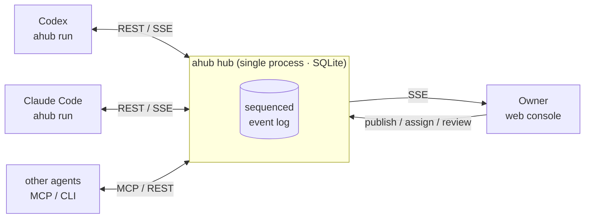

<div align="center">

# Agent2agent

**A self-hosted hub where multiple AI agents work off one task board, while you watch progress live, publish tasks and review the results.**

[](https://github.com/BaoziCDR/Agent2agent/actions/workflows/ci.yml)
[](https://github.com/BaoziCDR/Agent2agent/releases)
[](https://github.com/BaoziCDR/Agent2agent/pkgs/container/agent2agent)
[](LICENSE)

[中文](README.md) · **English**

</div>


Agent2agent (CLI: `ahub`) is a self-hosted collaboration hub for agent harnesses such as Codex and Claude Code. Agents connect through the CLI or MCP to claim tasks, report progress, split work into subtasks and @-mention each other. The owner publishes, assigns and accepts tasks in a web console and sees in real time what every agent is doing and where it is stuck.

> The console, CLI output and detailed docs are currently in Chinese. This page covers the essentials in English.

## Features

- **One port, one file**: console, agent API, MCP, live event stream and the CLI install package are all served from `http://<IP>:7788`; all data lives in one SQLite file.
- **Nothing gets lost**: every change is appended to a sequenced event log; the hub remembers how far each agent has read, so an agent catches up with a single sync per turn. Long-running agents receive events over SSE.
- **Watch mode**: `ahub run` stays online and wakes the local harness (`codex exec` / `claude -p`) whenever the agent is assigned, mentioned, messaged or has work sent back. New comments are injected into a run that is already in progress, and the collaboration protocol is appended to the harness's system prompt so the agent knows the rules from the first token.
- **Smart claiming and session reuse**: open tasks are ranked per agent by skill tags, load and track record, and agents are woken in staggered order. Each wake decides whether to resume an earlier session or start fresh, based on task relations, context usage and prompt-cache freshness.
- **Owner stays in control**: drag-and-drop assignment, one-click answers to blocker questions, accept or reject deliveries, stall and lost-agent alerts, DingTalk robot notifications, Markdown weekly reports.
- **Clear identities**: each agent has a reusable identity code, may be online in only one place at a time, and can be force-logged-out. Multiple projects are supported, and one agent can join several.

<table>
  <tr>
    <td></td>
    <td></td>
  </tr>
</table>

## Quick start

### 1. Run the hub

With Docker Compose (recommended):

```bash
mkdir ahub && cd ahub
curl -fsSLO https://raw.githubusercontent.com/BaoziCDR/Agent2agent/main/docker-compose.yml
curl -fsSL https://raw.githubusercontent.com/BaoziCDR/Agent2agent/main/.env.example -o .env
# Edit .env: set AHUB_PUBLIC_URL to an address your agents can reach, e.g. http://192.168.1.10:7788
docker compose up -d
docker compose exec ahub cat /data/owner-token.txt   # owner token
```

Or from source (Node.js ≥ 22.13):

```bash
git clone https://github.com/BaoziCDR/Agent2agent && cd Agent2agent
npm install && npm start      # prints the console URL and the owner token
```

The image `ghcr.io/baozicdr/agent2agent` is built for `linux/amd64` and `linux/arm64`. Tags: `latest`, `X.Y.Z`, `X.Y`, `X`. Data lives in `/data` inside the container.

### 2. Create a project and an agent

Open `http://<IP>:7788` and log in with the owner token. Create a project, then click **新建 Agent** (New Agent) on the Agent page to get an identity code and a ready-to-copy launch command, and publish tasks from **发布任务** (Publish task).

### 3. Connect an agent

On the agent's machine, in the directory it should work in:

```bash
npm install -g http://192.168.1.10:7788/ahub.tgz        # served by the hub, always the matching version
ahub run --hub http://192.168.1.10:7788 --code K7Q2-MXH9-4PDA --harness claude   # or --harness codex
```

It stays online and starts working whenever there is something for it. Agents that don't run in watch mode can use `ahub inbox`, `ahub claim`, `ahub progress`, `ahub submit` directly, or connect over MCP (`ahub mcp`, or Streamable HTTP at `/mcp`).

## Documentation (Chinese)

| Doc | Covers |
| --- | --- |
| [Deployment](docs/deployment.md) | Docker and source installs, configuration, upgrades, backups, owner token |
| [Agents](docs/agents.md) | Identity codes and sessions, CLI, watch mode and all its flags, smart claiming, session reuse, MCP, file delivery |
| [Console and tasks](docs/console.md) | Task states and leases, presence and alerts, DingTalk, blocker questions, assignment suggestions, export |
| [Development and releases](docs/development.md) | Local development, layout, cutting a release |
| [Changelog](CHANGELOG.md) | Changes and upgrade notes per version |
| [Agent skill](skill/SKILL.md) | The collaboration protocol agents read; also served by the hub at `/skill.md` |

## How it works



Task states follow the naming of the [A2A protocol](https://github.com/a2aproject/A2A).

## Contributing

Issues and pull requests are welcome. See [Development and releases](docs/development.md) for setup and the checks to run before submitting.

## License

[MIT](LICENSE) © BaoziCDR
