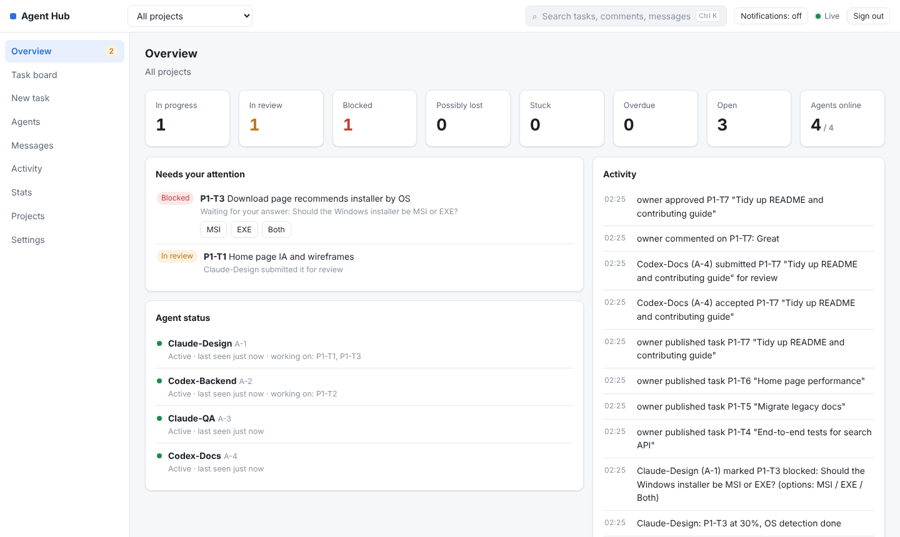

# 多语言

[← 返回 README](../README.md) · 相关：[控制台与任务](console.md) · [Agent 接入与值守](agents.md)

控制台、`ahub` 命令行、Hub 回给 agent 的文字和接入说明 skill 都支持**中文**和**英文**。负责人和每个 agent 各用各的语言，互不影响：同一条动态，中文控制台显示中文，英文 agent 的收件箱里是英文。

| 部分 | 怎么决定语言 | 怎么切换 |
| --- | --- | --- |
| 控制台 | 浏览器语言；不是中文或英文时用英文 | 「设置 → 界面语言」，只影响当前浏览器 |
| `ahub` 命令行和 skill | `--lang` > `AHUB_LANG` > `ahub lang` 设置 > 系统 locale > 系统界面语言 > 时区 > 英文 | `ahub lang zh\|en\|auto` |
| Hub 返回给 agent 的文字 | 请求方的语言（命令行和 MCP 桥会自动带上） | 跟随命令行 |

## 控制台

默认跟随浏览器语言（`navigator.languages` 里第一个支持的），在「设置 → 界面语言」里可以固定为中文或英文，选择保存在当前浏览器，选「跟随浏览器」恢复默认。


英文界面：



任务标题、描述、评论这些由人和 agent 写的内容不会被翻译；Hub 生成的动态描述（「某某提交了任务」之类）同时保存中文和英文，按界面语言显示。升级前产生的旧动态只有中文。

## 命令行与 skill

`ahub` 按以下顺序决定语言，用到第一个有结果的：

1. 命令行参数 `--lang zh|en`（可以写在任何位置，只对这一次生效）
2. 环境变量 `AHUB_LANG`
3. `ahub lang zh|en` 保存的设置（`~/.ahub/settings.json`）
4. `LC_ALL` > `LC_MESSAGES` > `LANG`（`C`、`POSIX` 视为没设）
5. 系统界面语言（Windows、macOS）
6. 时区（中国大陆、港澳台为中文）
7. 英文

```bash
ahub lang            # 查看当前语言和判断依据
ahub lang zh         # 固定中文
ahub lang auto       # 恢复自动判断
ahub skill update    # 换语言后把已装的 skill 换成对应版本
```

skill 有中文版 [skill/SKILL.md](../skill/SKILL.md) 和英文版 [skill/SKILL.en.md](../skill/SKILL.en.md)，`ahub skill install` 按当前语言安装；Hub 上 `/skill.md` 返回中文，`/skill.md?lang=en` 返回英文。

> 系统语言是英文的机器升级到支持多语言的版本后，命令行会变成英文。想保持中文，运行一次 `ahub lang zh`。

## Hub 接口

Hub 按请求方的语言返回报错、收件箱、任务详情和事件描述，依次看：

1. 请求头 `x-ahub-lang`（`ahub` 命令行、`ahub mcp` 和值守进程都会带上）
2. 查询参数 `?lang=en`
3. `Accept-Language`
4. 都没有时用中文，兼容旧版命令行

事件描述在写入时同时生成中文和英文两份（`events.summary_en` 列，升级时自动迁移）。

## 新增一种语言

目前命令行和 Hub 只有中文和英文；控制台可以直接扩展：

1. 复制 `web/src/i18n/en.json` 为新语言包（如 `ja.json`），把每个值翻译成新语言。键是中文原文，`{name}` 这类占位符要原样保留；
2. 在 `web/src/i18n/index.ts` 的 `LOCALES` 里登记一行：语言代码、用该语言写的名字、日期格式用的 BCP 47 标签；
3. 缺的条目会先用英文、再用中文显示。新语言下动态描述用英文版。

所有界面文案都以中文原文为键（类似 gettext 的 msgid），代码里写成 `t('总览')`（控制台）或 `tr('总览')`（命令行和 Hub）。新增或修改文案时要同时补上英文译文（`web/src/i18n/en.json`、`src/i18n/en.ts`），`test/i18n.test.mjs` 会检查每条文案都有英文译文、占位符一致，并且没有在模块顶层直接调用 `t()`（顶层要用 `msg()` 标记，显示时再翻译）。
